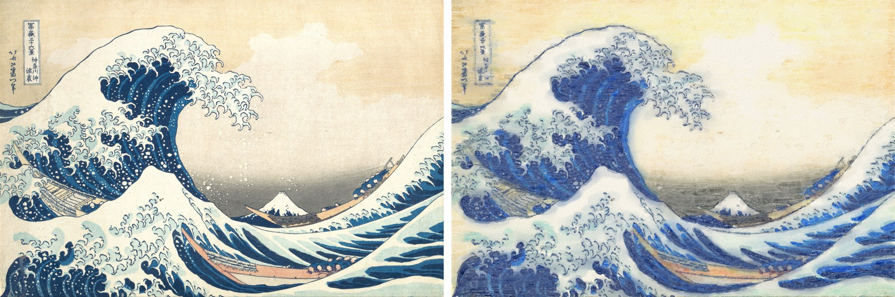

# paintkit

Code brushes that repaint any picture in watercolour, stroke by stroke. Every pixel of the result is laid by a
simulated brush on simulated paper. The source picture only says where strokes go and what colour they carry.




## Install

paintkit needs Python 3.10 or newer. `film` also needs [ffmpeg](https://ffmpeg.org/download.html) on the PATH.

With [uv](https://docs.astral.sh/uv/):

```bash
uv tool install git+https://github.com/codepawl/paintkit
```

With pip:

```bash
pip install git+https://github.com/codepawl/paintkit
```

To try it once without installing, put `uvx --from git+https://github.com/codepawl/paintkit` in front of a command.

## Use

Repaint a picture. `--size` sets the long side of the painting in pixels:

```bash
paintkit paint photo.jpg -o painting.png --size 2048
```

Film the painting stroke by stroke, and keep the finished painting too:

```bash
paintkit film photo.jpg -o painting.mp4 --size 1024 --still painting.png
```

| Option | Default | What it does |
| --- | --- | --- |
| `--size` | 2048 (`paint`), 1024 (`film`) | Long side of the output in pixels |
| `--seed` | 7 | Changes where strokes start. The same seed gives the same painting |
| `--seconds` | 22 | `film` only: time spent painting before the 2.5 s hold on the result |
| `--still` | none | `film` only: also save the finished painting as a PNG |
| `--verbose` | off | `paint` only: print each pass |

Time on one desktop CPU core: a 1400 px painting takes about 30 s and a 720 px film about 70 s. A 4096 px
painting takes 8 to 12 minutes.

## How it paints

- **Paper.** A cold-press height map holds the dried pigment as optical density per colour channel. It renders as
  the paper colour times `exp(-density)`, so washes glaze like transparent films and untouched paper stays white.
- **Washes.** Each pass is a wet layer. Strokes put water and pigment into it. When it dries, pigment bleeds wet into
  wet, gathers at the rim into a darker edge, grows back-runs with cauliflower edges and settles into the pits
  of the paper.
- **Strokes.** For each pass the painter measures how much pigment is still missing, seeds strokes there, traces each
  one along the picture's contours and stops it where the colour changes. Seven passes go from 64 px wet washes
  to 1.3 px dry details, lightest first.

## Python

```python
from PIL import Image
from paintkit import cli

picture = cli.load_target("photo.jpg", 1600)  # float sRGB, long side 1600 px
paper = cli.paint_picture(picture, seed=7)
Image.fromarray(cli.to_bytes(paper.render())).save("painting.png")
```

`paintkit.watercolour` is the paper and wash engine on its own: make a `Paper`, call `new_wash()`, lay strokes with
`deposit()` or any brush preset with `paint_stroke()`, then `dry()`. `paintkit.brushes` and `paintkit.core` are a
general raster brush engine with layers, blend modes, selections and fills (see `CONTRACT.md`).

## Develop

```bash
uv run --with numpy --with scipy --with scikit-image --with pillow --with pytest python -m pytest -q
```

## Licence

MIT. The example picture is Hokusai's *The Great Wave off Kanagawa* (c. 1831), public domain.
